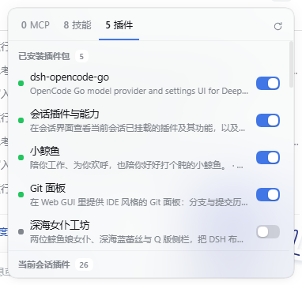
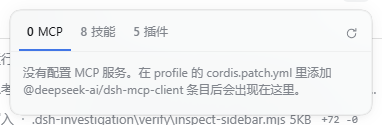
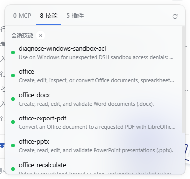

# 会话插件与能力 · Session Plugin View

DeepSeek Harness 的会话级 **插件 / MCP / 技能** 面板：会话标题栏右上角一个小图标，展开即可看到当前会话用到的插件、MCP 服务与技能，并可直接开关 MCP 与插件包。

A session-scoped plugin, MCP and skills panel for DeepSeek Harness, opened from a small icon at the top-right of the conversation header.

## 功能

- **MCP**：列出 profile 中配置的 MCP 服务（`@deepseek-ai/dsh-mcp-client` 条目），逐行开关，立即生效。
- **技能**：当前会话可用技能、说明与「仅手动」标记。
- **插件**：已安装插件包可整体启停；当前会话插件显示挂载状态（已挂载 / 条件启用 / 启动失败 / 已停用）。
- **Star 支持作者**：标签栏「MCP / 技能 / 插件」后有一个红心按钮，显示 GitHub 实时 Star 数；点击直接打开本仓库，在 GitHub 上点 Star 即可支持插件持续更新。
- 面板 portal 到 `document.body`，点击外部或 Esc 关闭；只读行会说明不能修改的原因。

## 截图







## 安装

```bash
# 从插件市场（发现 → 搜索会话插件与能力）
# 或命令行：
dsh plugin --profile desktop add dsh-plugin-session-view
```

开发模式（本地目录，把路径换成本仓库）：

```bash
dsh plugin --profile desktop add link:<本仓库绝对路径>
```

> 同一时间只保留一种安装方式：发布版补丁与本仓库开发版使用同一个 `id: session-plugin-view`，同时启用会出现重复条目。

## 兼容性

- DSH `>=0.2.1-rc.3 <0.3.0-0`
- 以 bundle 形式安装（声明 `dsh.bundle.patch`），客户端入口 `exports["./client"]`。
- MCP 服务本身需要在 profile 的 `cordis.patch.yml` 中先配置；面板只负责展示和启停。

## 仓库结构

```text
client.js             浏览器端插件（面板 UI、数据加载、启停开关）
index.js              Host 侧占位入口（面板不持有 Host 状态）
cordis.patch.yml      开发用补丁（发布时由 publish/prepare.mjs 改写包名）
locale/               中英文文案
icon.svg              插件图标
smoke.mjs             无浏览器冒烟测试（按 import.meta.url 解析路径）
publish/              发布工具：生成 npm 包与 format 1 市场索引
docs/                 README 截图（随仓库提交）
```

`publish/dist/` 是生成目录（`.gitignore` 默认忽略其中的 npm 包），不要当成源码提交。
工作区里的 `.dsh-investigation/` 是本机调查材料，不属于本插件，也不要上传。

## 开发

```bash
node smoke.mjs                      # 无浏览器冒烟测试（数据、开关、渲染分支、inject 守卫）
node publish/prepare.mjs --dry-run  # 生成可发布包与市场索引
```

## 发布

见 [publish/README.md](publish/README.md)：

- 发布到 npm，并提交到 [dshopen.org 开放插件市场](https://dshopen.org)（Issue 模板 + 收录条件 + 维护流程）；
- 或生成 format 1 的 `index.json`，托管成你自己的插件源市场（GitHub Pages / jsDelivr / 自建服务器），支持在 DSH「发现 → 添加索引源」中接入。

## 许可证

MIT
